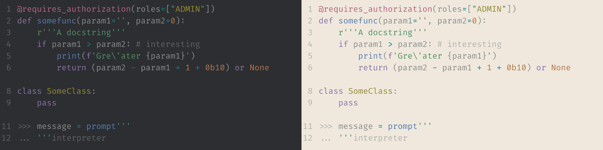
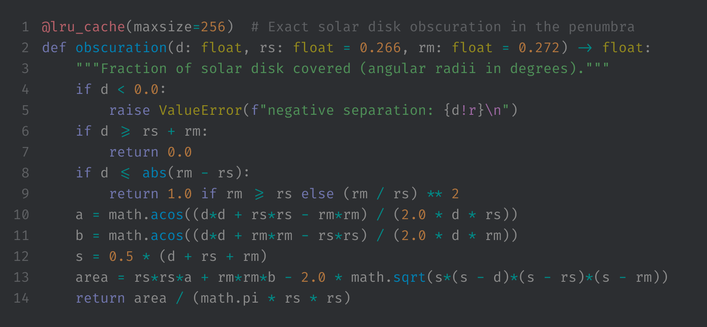
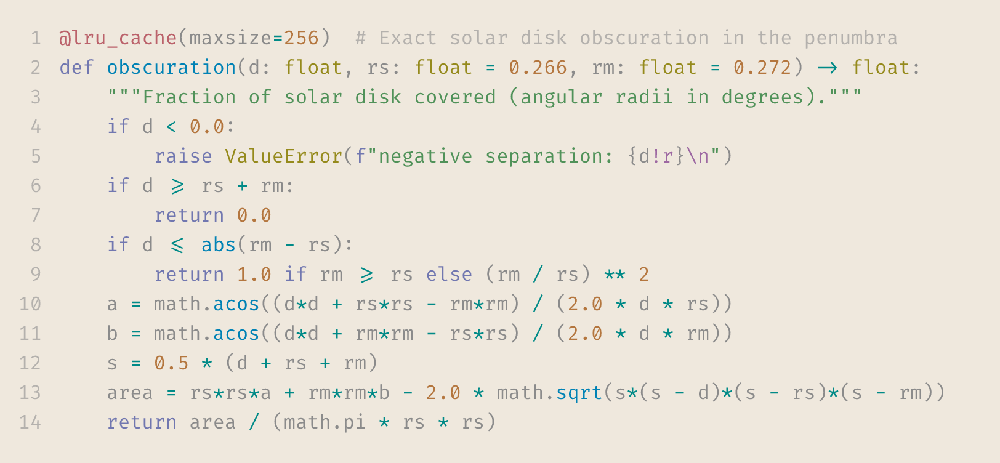
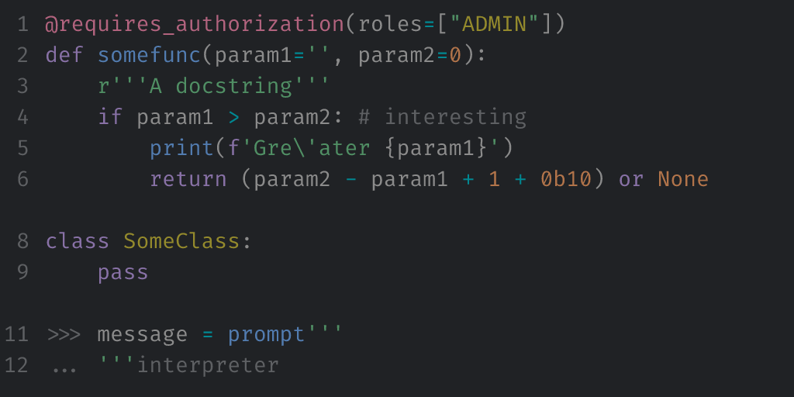
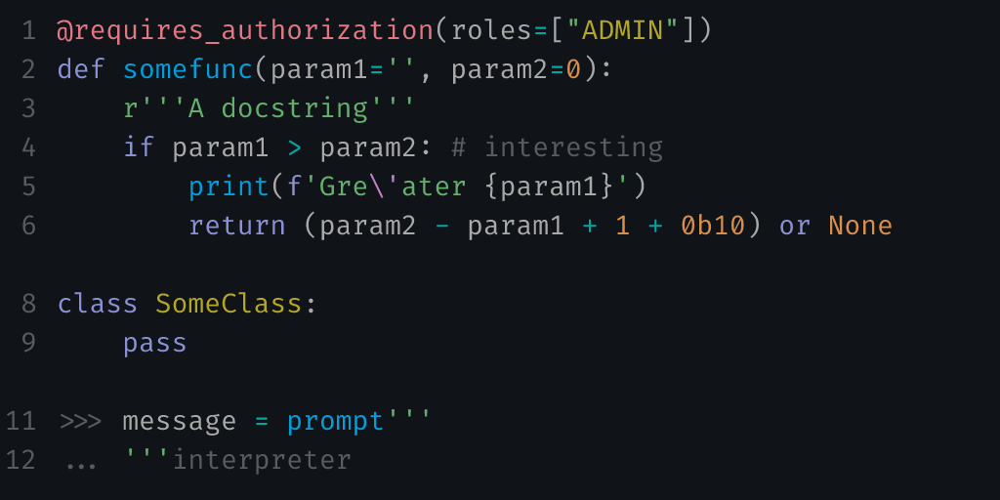
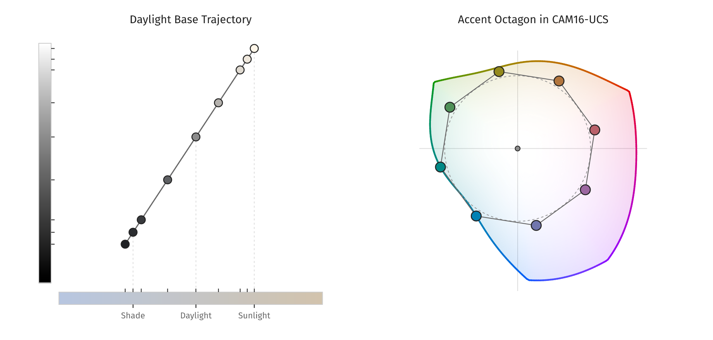

     
 

  

# Penumbra

Penumbra is an ergonomic colour scheme for code editors, terminals, and interfaces, modelled after the natural transition between warm sunlit surfaces and cool open shade.

High-contrast screens and uneven token brightness can strain the eyes and interrupt reading flow. Penumbra addresses both by placing its base tones along the CIE daylight curve at a balanced ~3:1 contrast and calibrating every accent colour to equal perceived brightness in a perceptually uniform colour space, so syntax categories stand out purely by hue without jarring jumps. Enhanced-contrast dark variants (`contrast+` and `contrast++`) are included for challenging viewing conditions.

[penumbra_base.tsv](penumbra_base.tsv) and [penumbra_accents.tsv](penumbra_accents.tsv) contain all colours given below as `rgb_hex`, `r` `g` `b` and `h` `s` `l` in the sRGB colour space, along with their coordinates in Revised CAM16-UCS (`cam16_ucs_lightness`, `cam16_ucs_chroma`, `cam16_ucs_hue`) and correlated colour temperature (`correlate_cct_k` for the base colours).

## Features

The goal of this colour scheme is to cleanly separate the use of each of the three perceptual properties of colour (lightness, chroma and hue) and optimally utilize the typically available colour space to encode information with each of them. Ergonomics and function are put before aesthetics, though the base colours modelled after natural daylight and low but sufficient contrast attempt to make the overall scheme pleasing to the eye.

### 1. Surfaces Mimic Natural Sunlight and Shade

Human vision evolved outdoors under natural daylight, where sunlit surfaces are warm and shadows are cooled by diffuse light from the sky. Because our colour constancy mechanisms are tuned to this natural daylight axis, Penumbra's base colours follow the CIE daylight locus continuously from warm direct sunlight through neutral daylight (CIE D65, the standard white point of consumer displays) into cool sky shade. Dark colours appearing like open shade and light colours like sunlit matte paper create a familiar, biophilic visual environment that fades into the background as that is what you are used to when going outside.

### 2. Just Enough Contrast (with High-Contrast Options)

In psychophysical reading studies, reading speed reaches near-maximal levels around a luminance ratio of 3:1 – the minimum display legibility threshold specified in ISO-9241-3 – with strongly diminishing returns above it. While legibility is important to reduce eye strain, for many people, excessive contrast on dense, repetitive lines of text also contributes to visual stress and pattern glare. Penumbra places its main text-to-background contrast right at this threshold, with two enhanced contrast dark variants available when ambient lighting or eyesight call for greater separation.

### 3. Fluidly Readable Text and Code

Resolving fine character shapes and tracking smoothly along a line of text rely primarily on luminance contrast, whereas chroma and hue excel at visual search and grouping across the page. Because the main text and all accent colours share the same perceived lightness within the colour appearance model, it is easier to read code like continuous text and follow logical structure without brightness differences between words disrupting the flow, while maintaining the ability to scan for highlighted tokens.

### 4. Optimal Hue Differentiability

By using the [Revised CAM16-UCS](https://doi.org/10.1002/col.22792) colour appearance model together with its [Helmholtz–Kohlrausch extension](https://doi.org/10.1002/col.22793), Penumbra achieves equal perceptual hue steps and equal modelled brightness across all accent colours, adapted separately for dark and light backgrounds. Saturated colours appear brighter to the human eye than a neutral grey of the same physical luminance (the Helmholtz–Kohlrausch effect). Compensating for this effect ensures that none of the accent colours stand out from or recede into the page more than others.

### 5. Maximum Colourfulness Within Display Limits

Within the constraints of equal hue spacing and uniform perceived lightness (including Helmholtz–Kohlrausch compensation), each discrete polygon of $N$ accent hues is rotated to maximize its constant chroma along the exact sRGB gamut boundary. Placing the discrete vertices around the gamut boundary preserves maximum chroma and categorical discriminability while keeping every accent colour balanced at the same perceived brightness.

## Examples

### Dark

### Light

### Dark Contrast+

### Dark Contrast++

## Available For / Installation

Use the default (`balanced`) themes for typical indoor lighting, and `contrast+` or `contrast++` for challenging viewing situations and mild visual impairment.

### Editors and IDEs

* **VS Code** available from the [extension marketplace](https://marketplace.visualstudio.com/items?itemName=PenumbraTheme.penumbra), [Open VSX](https://open-vsx.org/extension/PenumbraTheme/penumbra) or its own [repository](https://github.com/nealmckee/penumbra_vscode)
* **Vim / Neovim** colour scheme files in [`vim/`](./vim)
* **Helix** theme files in [`helix/themes/`](./helix/themes)
* **Sublime Text / TextMate (`tmTheme`)** theme files in [`tmtheme/`](./tmtheme) (also compatible with `bat` and `delta`)

### Terminal Emulators

All terminal themes default to the equally spaced 6-colour ANSI palette (`penumbra_dark`, `penumbra_dark+`, `penumbra_dark++`, `penumbra_light`) and also include semantic variants (`*_semantic6`, or `(Semantic 6)` in Windows Terminal) that map the six standard ANSI slots directly to the corresponding colours of the 8-colour syntax palette:

* **iTerm2** import `.itermcolors` files from [`iTerm2/`](./iTerm2) in the preferences pane
* **Ghostty** theme files in [`ghostty/themes/`](./ghostty/themes)
* **Kitty** configuration files in [`kitty/`](./kitty)
* **Alacritty** configuration files in [`alacritty/`](./alacritty)
* **WezTerm** colour scheme files in [`wezterm/colors/`](./wezterm/colors)
* **Warp** theme files in [`warp/themes/`](./warp/themes)
* **Windows Terminal** scheme definitions in [`windows-terminal/penumbra.json`](./windows-terminal/penumbra.json)
* **Zellij** theme files in [`zellij/themes/`](./zellij/themes)

### Other

* **Julia REPL with OhMyREPL** add the packages `OhMyREPL.jl` and `Crayons.jl` to your base environment and include one of the scripts from [`OhMyREPL.jl/`](./OhMyREPL.jl) in your `startup.jl`
* **Claude Code & Codex CLI** theme files in [`claude-code/`](./claude-code) and [`codex/`](./codex)
* **Base16** YAML schemes in [`base16/`](./base16)
* **CSS & Design Tools** CSS custom properties in [`css/penumbra.css`](./css/penumbra.css) and GIMP/Inkscape/Krita palettes in [`gpl/`](./gpl)

## Intended Usage

The recommended font is `Fira Code`.

### Base Colours

#### For a dark theme

* **Sun+** “white”, text in highlighted sections, emphasized borders
* **Sun** cursor, text selections (with transparency), light borders, strongly emphasized content
* **Sun-** optional
* **Sky+** emphasized content and emphasized UI text
* **Sky** foreground, code, main content colour, text both in editors and UI elements
* **Sky-** comments, de-emphasized content, subtle borders (with transparency)
* **Shade+** low-contrast UI chrome (sidebars, status bars, inactive tabs), rulers, indentation guides and similar
* **Shade** main background colour
* **Shade-** “black”, active/focused background elements, UI list selections, recessed UI elements

#### For a light theme

* **Shade-** “black”, text in highlighted sections, emphasized borders
* **Shade** cursor, text selections (with transparency), dark borders, strongly emphasized content
* **Shade+** optional
* **Sky-** emphasized content and emphasized UI text
* **Sky** foreground, code, main content colour, text both in editors and UI elements
* **Sky+** comments, de-emphasized content, subtle borders (with transparency)
* **Sun-** low-contrast UI chrome (sidebars, status bars, inactive tabs), rulers, indentation guides and similar
* **Sun** main background colour
* **Sun+** “white”, active/focused background elements, UI list selections, elevated UI elements

When additional in-between shades are desired, it’s recommended to use transparency to blend other appropriate base colours with the background colour.

Beyond these base roles, syntax and UI assignments follow directly from the construction symmetries: keep common identifiers and punctuation in neutral `sky`, de-emphasize comments solely by lightness (`sky-` or `sky+`), and assign distinct syntax categories around the equal-lightness accent circle so tokens that frequently appear adjacent in code receive well-separated (at minimum non-adjacent) hues. See the VS Code theme for a canonical implementation.

### Accent Colour Palettes

Used for syntax highlighting and wherever colour is required in the UI. If avoidable, do not use additional colours in the UI that aren’t required for content highlighting. Usually, context is enough to not confuse their uses – each additional colour just reduces differentiability.

**Choose one palette (as large as necessary, as small as possible) and never mix and match!** Otherwise, the advantages of hue optimization are lost. Editor and UI themes use the 8-colour palette to provide distinct hue categories across syntax roles. For ANSI terminals, the equidistant 6-colour palette is the default for maximum 60° hue spacing and highest chroma, while `*_semantic6` builds select the matching six colours (`red`, `yellow`, `green`, `cyan`, `blue`, `magenta`) from the 8-colour syntax palette when visual consistency between editor and terminal is preferred. A 7-colour palette is also exported in [`penumbra_accents.tsv`](penumbra_accents.tsv).

In 16-colour terminal palettes, ANSI slots 1–6 (`red`, `green`, `yellow`, `blue`, `magenta`, `cyan`) and 9–14 (`bright_*`) map identically to the six terminal accents, while the four neutral slots map to base tones: `black` (0) is `shade-`, `bright black` (8) is `sky-`, `white` (7) is `sun`, and `bright white` (15) is `sun+` in dark themes (mirroring to `sun-`, `sky+`, `shade`, and `shade-` in light themes).

If palettes smaller than 6 are desired, choose subsets as following:

* **5**: omit one colour from a six colour palette (**not recommended**)
* **4**: every other colour from an eight colour palette (two possible sets)
* **3**: every other colour from a six colour palette (two possible sets)
* **2**: every fourth colour from an eight colour palette or every third from a six colour palette (seven possible sets)

## Construction

Penumbra is formulated in Revised CAM16-UCS with Helmholtz–Kohlrausch brightness compensation under standard reference viewing conditions (D65 display whitepoint, sRGB gamut, average surround, and adapting luminance $L_A = 24\text{ cd/m}^2$). This accounts for how a dark (`shade`) versus a bright (`sun`) background alters perceived lightness and derives all base and accent colours from closed-form perceptual and gamut constraints.

### Base Colours

The nine base colours lie on a single continuous curve in CAM16-UCS coupling perceived lightness to correlated colour temperature along the CIE daylight locus. At the bright end, the curve is anchored where the daylight locus naturally touches the ceiling of the sRGB gamut at the colour temperature of direct sunlight (`sun+`), avoiding any gamut clipping. It crosses neutral D65 daylight at the main text colour (`sky`) and continues into cool sky shade (`shade-`), with the intermediate text tones (`sky+` and `sky-`) carrying the subtle warm and cool transition of a natural penumbra.

Along this curve, the colours sit on a regular lightness lattice evaluated under their respective dark and light background environments. Because thin font strokes require much larger lightness differences than broad UI surfaces to be clearly distinguished, the lattice uses a 3:1 ratio between typographic steps (separating background, comments, main text and emphasized text) and surface steps (separating the three `sun` or three `shade` background planes). From these boundary and symmetry constraints alone, a ~3:1 reading contrast in the light theme and a shade colour temperature matching standard north-sky daylight (CIE D75) emerge naturally.

In the enhanced-contrast dark variants (`contrast+` and `contrast++`), `shade` is lowered while `sky` is lifted symmetrically, widening the background-to-text separation along the typographic lattice (`7Δ → 9Δ → 11Δ`). Each contrast tier re-anchors the daylight trajectory so `sky` always passes through neutral CIE D65 (`6504 K`), keeping text achromatic while subtly deepening the cool tint of the `shade` surfaces.

### Accent Colour Palettes

Each accent palette (6, 7 or 8 colours) consists of equally spaced hues on a circle of constant CAM16-UCS chroma whose Helmholtz–Kohlrausch adjusted perceived lightness matches `sky`. Because each dark contrast tier lifts `sky` and re-anchors the base curve, `balanced`, `contrast+` and `contrast++` each derive their own adapted dark accent palette at progressively higher lightness and higher available chroma, alongside a single `balanced` light accent palette.

Each palette forms a regular $N$-gon rotated around the constant-lightness hue circle in CAM16-UCS. Because the sRGB gamut boundary at this lightness varies substantially with hue and pinches inward around cyan, evaluating uniform chroma strictly at the discrete $N$ vertices and choosing the hue rotation $h_0$ to avoid that constriction maximizes achievable chroma across all colours without clipping.

## Limitations

While Penumbra accounts for how the overall luminance of the dark or light background scales perceived lightness, it neglects chromatic simultaneous contrast. Because the `sun` and `shade` backgrounds have a subtle warm or cool tint along the daylight locus, the perceptual distance between the background and the accent colours is not strictly identical for every hue. Since the base colours have very low chroma, this effect is small and an acceptable trade-off for natural daylight tones. Local simultaneous contrast between adjacent UI panels or neighbouring words is likewise not modelled, as layout varies arbitrarily in practice.

More generally, any static colour appearance model assumes fixed average viewing conditions (screen brightness and ambient room illumination). In addition, the strength of the Helmholtz–Kohlrausch effect depends on the visual angle subtended by a stimulus: compensation derived from standard 2° colour patches slightly overestimates the perceived brightness glow of thin font strokes, and the exact perceived balance will vary slightly with font size, font weight, display resolution and viewing distance. Penumbra also inherits the known limitations of Revised CAM16-UCS and its H–K extension: residual hue non-linearity in the blue–purple region, eccentricity scaling pooled across Munsell lightness, and an H–K fit calibrated under average surround conditions. Despite these trade-offs, to my knowledge, no other existing model currently unifies a uniform colour space, viewing-environment adaptation and empirically calibrated Helmholtz–Kohlrausch compensation.

Because differences between the accent colours are solely in hue at constant lightness and chroma, people with colour vision deficiency (CVD) will have great difficulty discriminating between them. In complete dichromacy (red–green or blue–yellow colour blindness), a constant-lightness hue circle collapses onto a single opponent axis, leaving only two distinguishable hues – far too few for useful syntax highlighting. Designing an effective scheme for CVD requires encoding differences across lightness and chroma as well, which requires a different approach from the ground up.

Finally, legacy terminal applications that depend on large luminance differences between ANSI colours, rather than hue alone, will lose contrast under Penumbra's equal-lightness accents. Terminal themes also mirror the normal accent colours in the bright ANSI slots (9–14), relying on bold text or base foreground hierarchy where emphasis is needed.

## The Colours

### Base Colours

| name | balanced | contrast+ | contrast++ |
| --- | --- | --- | --- |
| sun+ | `#FFF6E9` | `#FFF6E9` | `#FFF6E9` |
| sun | `#EFE8DD` | `#EFE8DD` | `#EEE8DD` |
| sun- | `#DFD9D0` | `#DFD9D1` | `#DED9D2` |
| sky+ | `#B4B1AD` | `#BAB8B4` | `#C2C0BD` |
| sky | `#8B8B8B` | `#999999` | `#A9A9A9` |
| sky- | `#5E6063` | `#5B5D62` | `#575B62` |
| shade+ | `#383A3D` | `#292B30` | `#1B1E23` |
| shade | `#2C2E31` | `#1D2024` | `#101317` |
| shade- | `#202225` | `#131418` | `#07080B` |

### 8-Colour Accent Palette (Syntax & UI)

| colour | dark balanced | dark contrast+ | dark contrast++ | light balanced |
| --- | --- | --- | --- | --- |
| red | `#BA616A` | `#CD6B76` | `#E17782` | `#BB626B` |
| orange | `#B3763E` | `#C58145` | `#D88F4C` | `#B4763E` |
| yellow | `#948A1D` | `#A39720` | `#B4A724` | `#958A1C` |
| green | `#4F9158` | `#58A061` | `#62B06C` | `#509259` |
| cyan | `#008986` | `#009894` | `#00A8A4` | `#008A87` |
| blue | `#0081B4` | `#008FC6` | `#009EDB` | `#0082B5` |
| purple | `#7176AE` | `#7D82C0` | `#8A90D4` | `#7177B0` |
| magenta | `#9C67A1` | `#AC72B2` | `#BE7FC4` | `#9D68A2` |

### 6-Colour Accent Palette (Equidistant Terminal Default)

| colour | dark balanced | dark contrast+ | dark contrast++ | light balanced |
| --- | --- | --- | --- | --- |
| red | `#BA5B78` | `#CD6584` | `#E27092` | `#BB5C78` |
| yellow | `#B47632` | `#C68237` | `#DA8F3E` | `#B57632` |
| green | `#759122` | `#81A026` | `#8EB02A` | `#759221` |
| cyan | `#008B7C` | `#009989` | `#00AA98` | `#008C7D` |
| blue | `#007FBA` | `#008CCD` | `#009BE2` | `#0080BB` |
| magenta | `#836FAE` | `#917BBF` | `#A088D3` | `#8470AF` |

### 7-Colour Accent Palette

| colour | dark balanced | dark contrast+ | dark contrast++ | light balanced |
| --- | --- | --- | --- | --- |
| red | `#AB6094` | `#BD6AA3` | `#D076B4` | `#AC6195` |
| orange | `#BA694F` | `#CD7458` | `#E28061` | `#BC6950` |
| yellow | `#A58222` | `#B68F26` | `#C89D2A` | `#A68222` |
| green | `#5D9245` | `#66A14C` | `#71B254` | `#5D9345` |
| cyan | `#008A82` | `#009890` | `#00A89F` | `#008B83` |
| blue | `#0080B6` | `#008EC9` | `#009DDE` | `#0081B8` |
| purple | `#7973AE` | `#857FC0` | `#938DD3` | `#7A74AF` |

## Releases & Legacy Versions

The original Oklab-based formulation of Penumbra is preserved under release tag [`v1.0.0`](https://github.com/nealmckee/penumbra/releases/tag/v1.0.0). If you require the legacy v1 palette tables or swatches, check out or download the `v1.0.0` tag.

## Contributions

Any implementations or ports, as well as improvements and additional features for existing ones, are very welcome. Just submit a pull request here or in the respective repository, or open an issue.

## Acknowledgments

The search for a theme led me to [Solarized](https://github.com/altercation/solarized) by Ethan Schoonover, which I was ultimately not satisfied with but inspired me to try and improve on its ideas.

[Oklab](https://bottosson.github.io/posts/oklab/) by Björn Ottosson gave me the tools to design the first version of the colours, and the work of Luke Hellwig, Dale Stolitzka and Mark D. Fairchild on [Revised CAM16-UCS](https://doi.org/10.1002/col.22792) and its [Helmholtz–Kohlrausch extension](https://doi.org/10.1002/col.22793) provided the foundation for v2.

[Colors.jl](https://github.com/JuliaGraphics/Colors.jl) for the Julia language made it effortless to work with colour spaces in a systematic way.

Large language models were used for coding assistance, generating the downstream application ports and updating the documentation for v2.

## License

Penumbra is distributed under a dual-licensing model (see [`LICENSE.txt`](LICENSE.txt)):

* **Palettes, Themes, Swatches and Documentation ([MIT License](LICENSE.txt)):** All exported colour tables (`penumbra_base.tsv`, `penumbra_accents.tsv`), editor and terminal themes, swatches and documentation are freely available under the MIT License.
* **Solver Source Code and Generator Scripts ([PolyForm Noncommercial 1.0.0](src/LICENSE-POLYFORM.txt)):** The colour appearance modelling code, optimization solvers and generator scripts in [`src/`](./src) and [`scripts/`](./scripts) are licensed under the PolyForm Noncommercial License 1.0.0.
* **Bundled Fonts ([SIL Open Font License 1.1](fonts/OFL.txt)):** The `Fira Sans` and `Fira Code` fonts in [`fonts/`](./fonts) used to render the swatch and example graphics are licensed under the SIL Open Font License 1.1.
