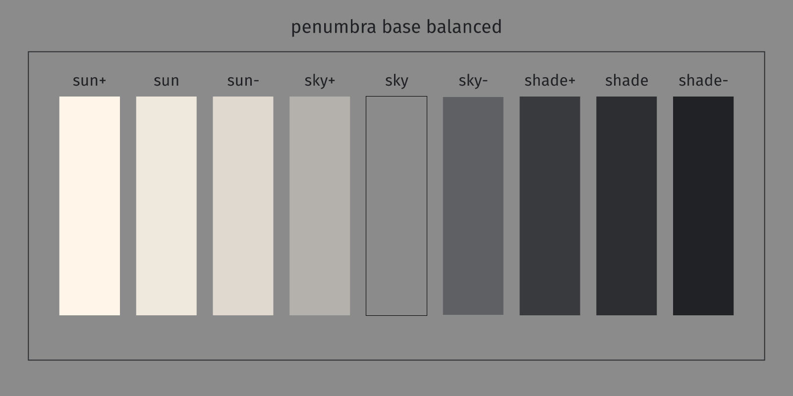
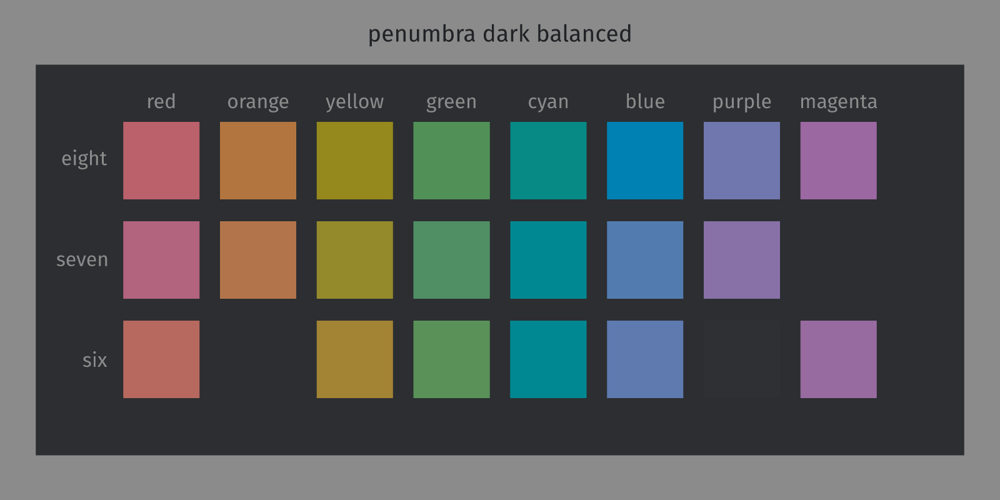
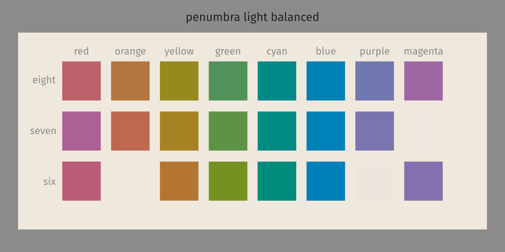

     
 

# Penumbra

Penumbra is an ergonomically designed, mathematically balanced colour scheme constructed in a perceptually uniform colour appearance space for customizable user interfaces and text editors. It cleanly separates the perceptual properties of colour (lightness, chroma and hue) while optimally utilizing the available colour space of typical displays.

The nine base colours follow the natural transition of daylight from sunlit surfaces through neutral daylight into cool sky-lit shade. They are used to build the main light and dark themes, drawing from differently sized accent colour palettes as necessary. Additionally, there are two variants of the dark theme with enhanced contrast, ideal for bright ambient environments or anyone with mild to moderate visual impairments. Due to the constraints of the design principles, none of the variants are suitable for people with colour vision deficiency.

[penumbra_base.tsv](penumbra_base.tsv) and [penumbra_accents.tsv](penumbra_accents.tsv) contain all colours given below as `rgb_hex`, `r` `g` `b` and `h` `s` `l` in the sRGB colour space, along with their coordinates in Revised CAM16-UCS (`cam16_ucs_lightness`, `cam16_ucs_chroma`, `cam16_ucs_hue`) and correlated colour temperature (`correlate_cct_k` for the base colours).

## Features

The goal of this colour scheme is to cleanly separate the use of each of the three perceptual properties of colour (lightness, chroma and hue) and optimally utilize the typically available colour space to encode information with each of them. Ergonomics and function are put before aesthetics, though the base colours modelled after natural daylight and low but sufficient contrast attempt to make the overall scheme pleasing to the eye.

### 1. Biophilic Base Colours

Human vision evolved outdoors under natural daylight, where sunlit surfaces are warm and shadows are cooled by diffuse light from the sky. Because our colour constancy mechanisms are tuned to this natural daylight axis, Penumbra's base colours follow the CIE daylight locus continuously from warm direct sunlight through neutral daylight (CIE D65, the standard white point of consumer displays) into cool sky shade. Dark colours appearing like open shade and light colours like sunlit matte paper create a familiar, biophilic visual environment that fades into the background as that is what you are used to when going outside.

### 2. Just Enough Contrast

In psychophysical reading studies, reading speed reaches near-maximal levels around a luminance ratio of 3:1 – the minimum display legibility threshold specified in ISO-9241-3 – with strongly diminishing returns above it. While legibility is important to reduce eye strain, for many people, excessive contrast on dense, repetitive lines of text also contributes to visual stress and pattern glare. Penumbra places its main text-to-background contrast right at this threshold, with two enhanced contrast dark variants available when ambient lighting or eyesight call for greater separation.

### 3. Fluidly Readable Text and Code

Resolving fine character shapes and tracking smoothly along a line of text rely primarily on luminance contrast, whereas chroma and hue excel at visual search and grouping across the page. Because the main text and all accent colours share the same perceived lightness within the colour appearance model, it is easier to read code like continuous text and follow logical structure without brightness differences between words disrupting the flow, while maintaining the ability to scan for highlighted tokens.

### 4. Optimal Hue Differentiability

By using the [Revised CAM16-UCS](https://doi.org/10.1002/col.22792) colour appearance model together with its [Helmholtz–Kohlrausch extension](https://doi.org/10.1002/col.22793), Penumbra achieves equal perceptual hue steps and equal modelled brightness across all accent colours, adapted separately for dark and light backgrounds. Saturated colours appear brighter to the human eye than a neutral grey of the same physical luminance (the Helmholtz–Kohlrausch effect); compensating for this effect ensures that none of the accent colours stand out from or recede into the page more than others.

### 5. Perceptually Anchored Hues

Within the constraints of equal hue spacing and constant chroma, the hue rotation of each palette is aligned to minimize the angular distance to the four psychological unique hues of human opponent colour vision in CAM16: red, yellow, green and blue. This anchors the palettes directly in the colour appearance model rather than relying on culturally specific colour naming surveys, while the equal hue spacing naturally places the remaining colours in the intermediate regions (orange, cyan, purple, magenta).

## Examples

### Dark

### Light

### Dark Contrast+

### Dark Contrast++

## Available For / Installation

### Editors and IDEs

* **VS Code** available from the [extension marketplace](https://marketplace.visualstudio.com/items?itemName=PenumbraTheme.penumbra), [Open VSX](https://open-vsx.org/extension/PenumbraTheme/penumbra) or its own [repository](https://github.com/nealmckee/penumbra_vscode)
* **Vim / Neovim** colour scheme files in [`vim/`](./vim)
* **Helix** theme files in [`helix/themes/`](./helix/themes)
* **Sublime Text / TextMate (`tmTheme`)** theme files in [`tmtheme/`](./tmtheme) (also compatible with `bat` and `delta`)

### Terminal Emulators

* **iTerm2** import `.itermcolors` files from [`iTerm2/`](./iTerm2) in the preferences pane
* **Ghostty** theme files in [`ghostty/themes/`](./ghostty/themes)
* **Kitty** configuration files in [`kitty/`](./kitty)
* **Alacritty** configuration files in [`alacritty/`](./alacritty)
* **WezTerm** colour scheme files in [`wezterm/colors/`](./wezterm/colors)
* **Warp** theme files in [`warp/themes/`](./warp/themes)
* **Windows Terminal** scheme definitions in [`windows-terminal/penumbra.json`](./windows-terminal/penumbra.json)

### Other

* **Julia REPL with OhMyREPL** add the packages `OhMyREPL.jl` and `Crayons.jl` to your base environment and include one of the scripts from [`OhMyREPL.jl/`](./OhMyREPL.jl) in your `startup.jl`
* **Claude Code & Codex CLI** theme files in [`claude-code/`](./claude-code) and [`codex/`](./codex)
* **Base16** YAML schemes in [`base16/`](./base16)
* **CSS & Design Tools** CSS custom properties in [`css/penumbra.css`](./css/penumbra.css) and GIMP/Inkscape/Krita palettes in [`gpl/`](./gpl)

## Intended Usage

The recommended font is `Fira Code`.

### Base Colours

#### For a dark theme

* **Sun+** “white”, text in highlighted sections, emphasized borders
* **Sun** selections, light borders, strongly emphasized content
* **Sun-** optional
* **Sky+** emphasized content and emphasized UI text
* **Sky** foreground, code, main content colour, text both in editors and UI elements
* **Sky-** comments, de-emphasized content
* **Shade+** foreground UI elements, sidebars, rulers, indentation guides and similar
* **Shade** main background colour
* **Shade-** “black”, active/focused background elements, selections, recessed UI elements

#### For a light theme

* **Shade-** “black”, text in highlighted sections, emphasized borders
* **Shade** selections, dark borders, strongly emphasized content
* **Shade+** optional
* **Sky-** emphasized content and emphasized UI text
* **Sky** foreground, code, main content colour, text both in editors and UI elements
* **Sky+** comments, de-emphasized content
* **Sun-** foreground UI elements, sidebars, rulers, indentation guides and similar
* **Sun** main background colour
* **Sun+** “white”, active/focused background elements, selections, elevated UI elements

When additional in-between shades are desired, it’s recommended to use transparency to blend other appropriate base colours with the background colour.

See the VS Code theme for an example of canonical usage.

### Accent Colour Palettes

Used for syntax highlighting and wherever colour is required in the UI. If avoidable, do not use additional colours in the UI that aren’t required for content highlighting. Usually, context is enough to not confuse their uses – each additional colour just reduces differentiability.

**Choose one palette (as large as necessary, as small as possible) and never mix and match!** Otherwise, the advantages of hue optimization are lost. The 6-colour palette matches standard ANSI terminal slots, the 7-colour palette suits rich syntax highlighting, and the 8-colour palette provides four symmetric opponent pairs when an additional category is needed.

If palettes smaller than 6 are desired, choose subsets as following:

* **5** omit one colour from a six colour palette (**not recommended**)
* **4** every other colour from an eight colour palette (two possible sets)
* **3** every other colour from a six colour palette (two possible sets)
* **2** every third colour from a six colour palette (three possible sets)
* **1** any one colour from a six colour palette (or any palette)

## Construction

While the first version of Penumbra used Oklab and hand-tuned luminances as a practical approximation, v2 formulates the entire scheme in Revised CAM16-UCS with Helmholtz–Kohlrausch brightness compensation. This accounts for how a dark (`shade`) versus a bright (`sun`) background alters perceived lightness, and replaces manual tuning and survey fitting with closed-form constraints.

### Base Colours

The nine base colours lie on a single continuous curve in CAM16-UCS coupling perceived lightness to correlated colour temperature along the CIE daylight locus. At the bright end, the curve is anchored where the daylight locus naturally touches the ceiling of the sRGB gamut at the colour temperature of direct sunlight (`sun+`), avoiding any gamut clipping. It crosses neutral D65 daylight at the main text colour (`sky`) and continues into cool sky shade (`shade-`), with the intermediate text tones (`sky+` and `sky-`) carrying the subtle warm and cool transition of a natural penumbra.

Along this curve, the colours sit on a regular lightness lattice evaluated under their respective dark and light background environments. Because thin font strokes require much larger lightness differences than broad UI surfaces to be clearly distinguished, the lattice uses a 3:1 ratio between typographic steps (separating background, comments, main text and emphasized text) and surface steps (separating the three `sun` or three `shade` background planes). From these boundary and symmetry constraints alone, a ~3:1 reading contrast in the light theme and a shade colour temperature matching standard north-sky daylight (CIE D75) emerge naturally.

Because `sky` acts as a fixed neutral pivot, the `sky` and `sun` colours remain identical across all variants. The `contrast+` and `contrast++` dark themes are formed simply by shifting the three `shade` roles down the same lattice by one and two surface steps respectively (so `shade` in `contrast+` is identical to `shade-` in `balanced`).

### Accent Colour Palettes

Each accent palette (6, 7 or 8 colours) consists of equally spaced hues on a circle of constant CAM16-UCS chroma whose Helmholtz–Kohlrausch perceived lightness matches `sky`. Because `sky` is shared across all contrast tiers, a single dark accent set and a single light accent set serve all theme variants.

Rather than restricting chroma to a full circle inside the sRGB gamut, the maximum chroma is determined only for the discrete points of the palette at a given hue rotation (forming a regular polygon in colour space). Because the sRGB gamut at this lightness is most restricted around cyan, rotating the palette so that no colour lands directly on that minimum allows for slightly higher chroma across all colours without clipping. The hue rotation of the polygon is solved analytically via the circular weighted mean aligning the vertices with the four CAM16 unique hues.

## Limitations

While Penumbra accounts for how the overall luminance of the dark or light background scales perceived lightness, it neglects chromatic simultaneous contrast. Because the `sun` and `shade` backgrounds have a subtle warm or cool tint along the daylight locus, the perceptual distance between the background and the accent colours is not strictly identical for every hue. Since the base colours have very low chroma, this effect is small and an acceptable trade-off for natural daylight tones. Local simultaneous contrast between adjacent UI panels or neighbouring words is likewise not modelled, as layout varies arbitrarily in practice.

More generally, any static colour appearance model assumes fixed average viewing conditions (screen brightness and ambient room illumination). In addition, the strength of the Helmholtz–Kohlrausch effect depends on the visual angle subtended by a stimulus: compensation derived from standard 2° colour patches slightly overestimates the perceived brightness glow of thin font strokes, and the exact perceived balance will vary slightly with font size, font weight, display resolution and viewing distance.

Because differences between the accent colours are solely in hue at constant lightness and chroma, people with colour vision deficiency (CVD) will have great difficulty discriminating between them. In complete dichromacy (red–green or blue–yellow colour blindness), a constant-lightness hue circle collapses onto a single opponent axis, leaving only two distinguishable hues – far too few for useful syntax highlighting. Designing an effective scheme for CVD requires encoding differences across lightness and chroma as well, which requires a different approach from the ground up.

Finally, some legacy terminal applications rely on the large luminance differences between traditional ANSI terminal colours, both against each other and against the background. Because Penumbra intentionally equalizes the lightness of all accent colours, legibility in such applications can suffer drastically. If you regularly use such applications, this scheme is sadly just not for you. Terminal themes also purposefully omit separate "bright" ANSI colours, as modern terminal emulators use bold text or base foreground hierarchy where emphasis is needed.

## The Colours

### Base Colours

| name | balanced | contrast+ | contrast++ |
| --- | --- | --- | --- |
| sun+ | `#FFF6E9` | `#FFF6E9` | `#FFF6E9` |
| sun | `#EFE8DD` | `#EFE8DD` | `#EFE8DD` |
| sun- | `#DFD9D0` | `#DFD9D0` | `#DFD9D0` |
| sky+ | `#B4B1AD` | `#B4B1AD` | `#B4B1AD` |
| sky | `#8B8B8B` | `#8B8B8B` | `#8B8B8B` |
| sky- | `#5E6063` | `#5E6063` | `#5E6063` |
| shade+ | `#383A3D` | `#2C2E31` | `#202225` |
| shade | `#2C2E31` | `#202225` | `#151619` |
| shade- | `#202225` | `#151619` | `#0A0B0D` |

### Accent Colour Palettes

| colour | 6 dark | 7 dark | 8 dark | 6 light | 7 light | 8 light |
| --- | --- | --- | --- | --- | --- | --- |
| red | `#B7695F` | `#B2637E` | `#BA616B` | `#B86960` | `#B4637F` | `#BB626C` |
| orange | | `#B2744A` | `#B3753F` | | `#B3754A` | `#B3763F` |
| yellow | `#A38334` | `#948A2C` | `#95891E` | `#A48334` | `#948A2C` | `#958A1D` |
| green | `#599159` | `#508F64` | `#519158` | `#599159` | `#509064` | `#519258` |
| cyan | `#008892` | `#008892` | `#078986` | `#008993` | `#008994` | `#078A87` |
| blue | `#5E7AAF` | `#527CB0` | `#0081B3` | `#5F7BB0` | `#537DB2` | `#0082B5` |
| purple | | `#8871A6` | `#7076AE` | | `#8972A7` | `#7177AF` |
| magenta | `#986BA0` | | `#9B68A1` | `#996CA1` | | `#9C69A2` |

## Releases & Legacy Versions

The original Oklab-based formulation of Penumbra is preserved under release tag [`v1.0.0`](https://github.com/nealmckee/penumbra/releases/tag/v1.0.0). If you require the legacy v1 palette tables or swatches, check out or download the `v1.0.0` tag.

## Contributions

Any implementations or ports, as well as improvements and additional features for existing ones, are very welcome. Just submit a pull request here or in the respective repository, or open an issue.

## Acknowledgments

The search for a theme led me to [Solarized](https://github.com/altercation/solarized) by Ethan Schoonover, which I was ultimately not satisfied with but inspired me to try and improve on its ideas.

[Oklab](https://bottosson.github.io/posts/oklab/) by Björn Ottosson gave me the tools to design the first version of the colours, and the work of Luke Hellwig, Dale Stolitzka and Mark D. Fairchild on [Revised CAM16-UCS](https://doi.org/10.1002/col.22792) and its [Helmholtz–Kohlrausch extension](https://doi.org/10.1002/col.22793) provided the foundation for v2.

[Colors.jl](https://github.com/JuliaGraphics/Colors.jl) for the Julia language made it effortless to work with colour spaces in a systematic way.

Large language models were used for coding assistance, generating the downstream application ports and updating the documentation for v2.

## License

Penumbra is distributed under a dual-licensing model (see [`LICENSE.txt`](LICENSE.txt)):

* **Palettes, Themes, Swatches and Documentation ([MIT License](LICENSE.txt)):** All exported colour tables (`penumbra_base.tsv`, `penumbra_accents.tsv`), editor and terminal themes, swatches and documentation are freely available under the MIT License.
* **Solver Source Code and Generator Scripts ([PolyForm Noncommercial 1.0.0](src/LICENSE-POLYFORM.txt)):** The colour appearance modelling code, optimization solvers and generator scripts in [`src/`](./src) and [`scripts/`](./scripts) are licensed under the PolyForm Noncommercial License 1.0.0.
* **Bundled Fonts ([SIL Open Font License 1.1](fonts/OFL.txt)):** The `Fira Sans` and `Fira Code` fonts in [`fonts/`](./fonts) used to render the swatch and example graphics are licensed under the SIL Open Font License 1.1.
